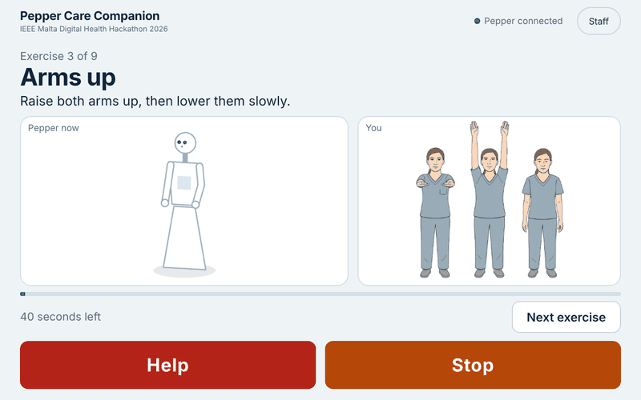
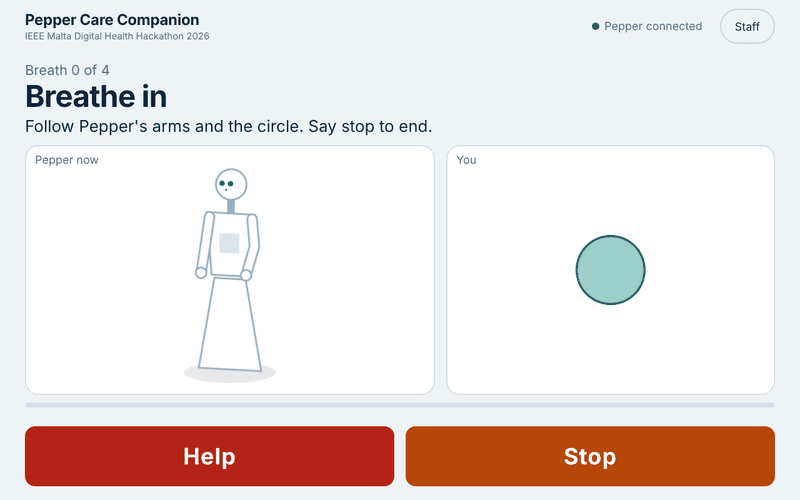
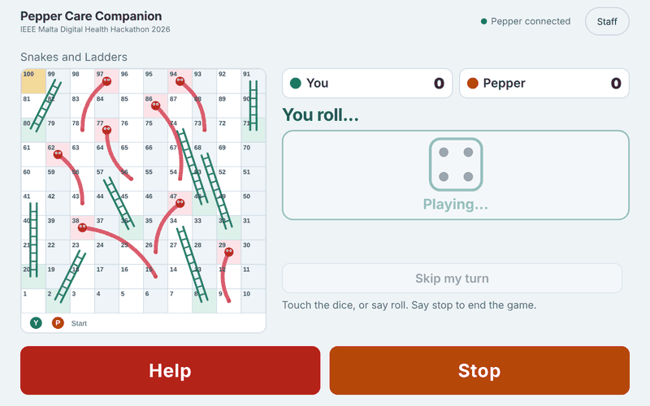

<h1 align="center">Pepper use cases</h1>

Use cases for the Pepper humanoid robot, built with Choregraphe 2.5 (NAOqi 2.5, Python 2.7 boxes, QiChat dialog) and a tablet web UI.

  

  
  

The Pepper tablet in action: guided exercise, calm breathing and snakes and ladders.

## Use cases

| Folder | Use case |
|---|---|
| [home-care](home-care) | Pepper Care Companion: a care home activity companion for health care professionals (IEEE Malta Digital Health Hackathon 2026) |

Each use case lives in its own sub directory with its own README.
