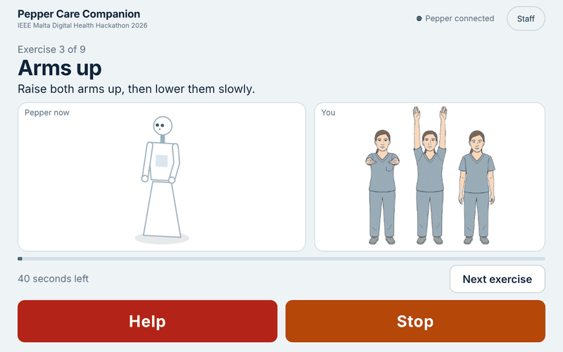
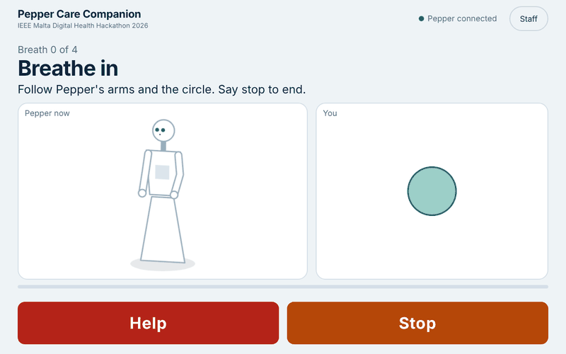
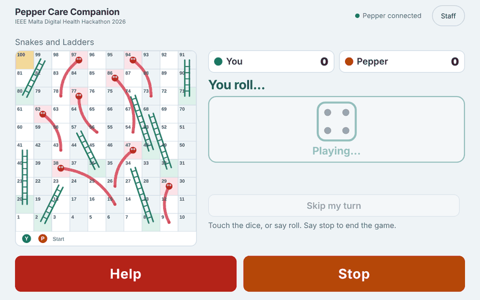
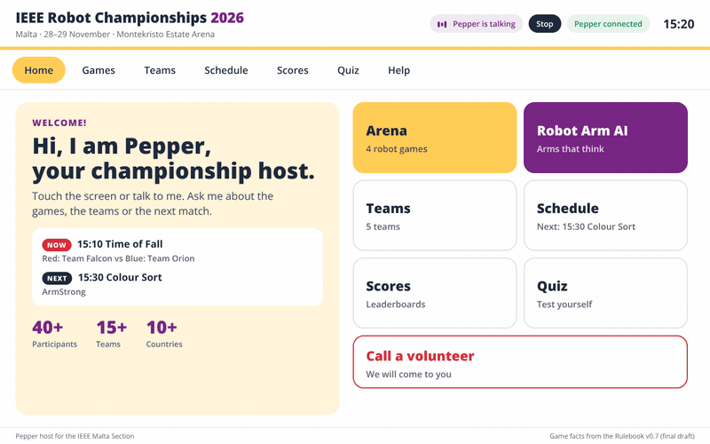
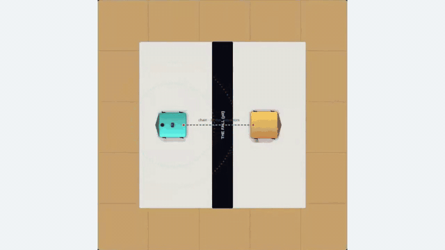
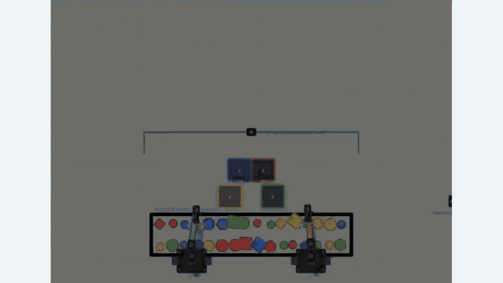

<h1 align="center">Pepper use cases</h1>

Use cases for the Pepper humanoid robot, built with Choregraphe 2.5 (NAOqi 2.5, Python 2.7 boxes, QiChat dialog) and a tablet web UI. Everything runs on the robot, with no cloud service.

| # | Folder | Use case |
|---|---|---|
| 1 | [home-care](home-care) | **Pepper Care Companion**: a care home activity companion for health care professionals (IEEE Malta Digital Health Hackathon 2026) |
| 2 | [robotic-championships](robotic-championships) | **Pepper Championship Host**: the neutral, official host of the IEEE Robot Championships 2026 in Malta |

---

## 1. Home care: Pepper Care Companion

  

  
  

Guided exercise, calm breathing and snakes and ladders on Pepper's tablet.

Pepper greets residents by name, checks in on medicine, leads exercise and breathing, plays music, quizzes and Malta memory cards, and alerts the care staff. [Read more](home-care)

---

## 2. Robotic championships: Pepper Championship Host

  

  
  

A tour of the host tablet, then the four Arena games and the Robot Arm AI Challenge (simulations, used to explain the rules).

Pepper welcomes visitors, explains every game, shows the teams, the programme and provisional scores, runs a robot quiz, calls a volunteer when someone needs help, and calls the teams ten minutes before their match. Every team is treated the same way. [Read more](robotic-championships)

---

Each use case lives in its own sub directory with its own README, the Choregraphe project, and its tests.
