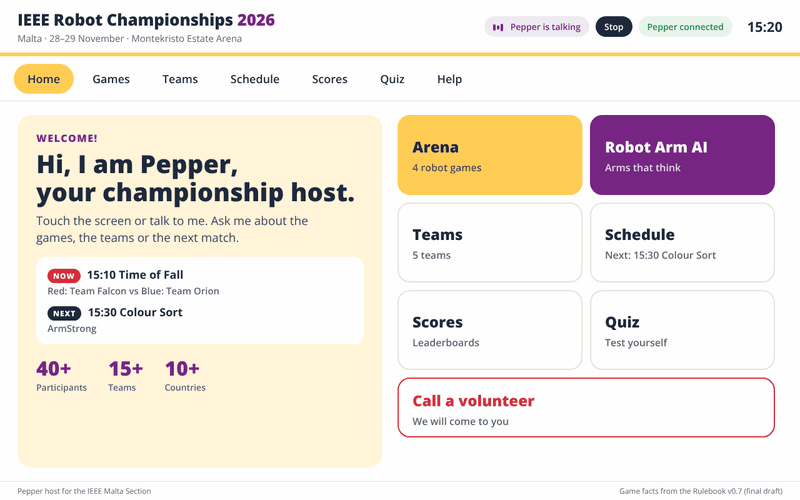
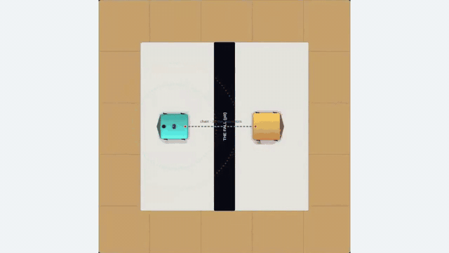
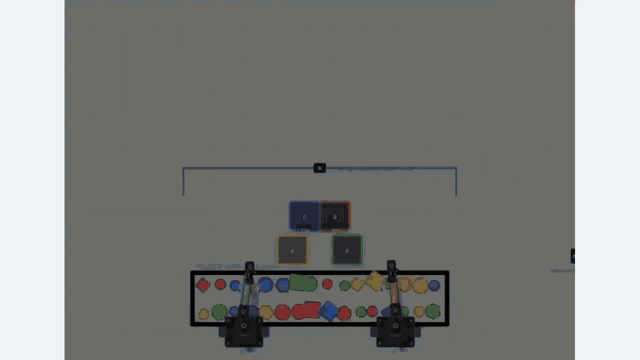

<h1 align="center">Robotic championships: Pepper Championship Host (v1.0.1)</h1>

  

  
  

Tablet tour with the official teams (8 Arena, 5 Robot Arm; no scores yet), the four Arena games, then the six Robot Arm AI Challenge rounds. The game clips are simulations, used to explain the rules.

**Folders:**
- `ChampionshipHost/`: the Choregraphe project. Open `ChampionshipHost.pml`.
- `docs/`: this guide, a one-page `STAFF_CARD.md` for volunteers, and screenshots.
- `src/`: the Host Controller source, built into the project with `build.py`.
- `tests/`: all checks, including a fit check of every screen at 1280 x 800; run `bash tests/run_all.sh`.
- `tools/`: the script that cut the neutral clips.
- `GATES.md`: what is verified and what still needs the robot.

Pepper as the neutral, official host of the **IEEE Robot Championships 2026** (28 and 29 November, Montekristo Estate Arena, Malta), built for the IEEE Malta Section.

Pepper welcomes visitors, explains the four Arena games and the Robot Arm AI Challenge with short animated clips, shows the teams, the programme and provisional scores, runs a robot quiz for children, calls a volunteer when someone needs help, and calls the two teams ten minutes before each match.

Every team is treated the same way. Pepper never comments on a team, never favours one, and never states an official result: scores on the screen are marked provisional, and the judges announce the results.

Everything runs on the robot. Nothing is sent to the internet.

## What visitors can do

| On the tablet | Or say | What happens |
|---|---|---|
| Arena, Robot Arm AI | "the arena", "robot arm challenge" | The games, with an animated clip for each one |
| A game card | "what is time of fall", "explain pouring" | The clip plays, three key facts, and Pepper explains it |
| Teams | "which teams", "tell me about team ..." | Every team as a card; Pepper says where they come from and their next match |
| Schedule | "what is next", "who is playing now" | The programme, with NOW and NEXT |
| Scores | "who is winning", "scores" | Provisional leaderboards for both competitions |
| Quiz | "quiz", then "one", "two", "three" | Five random questions about the games |
| Call a volunteer | "help", "I am lost", "first aid" | A red alert on the staff screen; Pepper says a volunteer is coming |
| Help | "toilets", "food" | Good-to-know answers (edit them in `html/data/content.json`) |

Pepper also answers "who are you", "what time is it", "thank you" and "goodbye", and says hello when someone comes close (at most every 45 seconds).

## Install and start

1. Unzip into a new folder. Open `ChampionshipHost/ChampionshipHost.pml` in Choregraphe 2.5 and connect to Pepper.
2. Click the **Host Controller** box and set the box parameters:
   - **Staff PIN**: change it from `2026` before the event.
   - **Match calls**: on by default.
   - **Greet visitors**: on by default.
3. Fill in the teams and the programme (see below). You can also do this later on the tablet.
4. Optional: put the official `logo.png` and `mascot.png` in `html/brand/` (see the README there). Without them the tablet shows the text title only.
5. Press **Play once**. In the log you should see `[Host] v1.0.1 running. N teams, M programme items, content loaded`, then about 4 seconds later `[Host] the dialog answers: Pepper is listening`.
6. For the event, install the app on the robot (Choregraphe: Robot applications, install) so it survives a reboot.

**Clean start.** Choregraphe can leave a dialog loaded from an earlier run. If the log says the dialog does not answer, or the tablet shows **Voice not ready**:
- Stop all behaviours and start the app once.
- If that does not help, restart the robot.

The tablet keeps working either way.

## Teams and programme

Both files are in `html/data/` and open in Excel or any text editor. Lines starting with `#` are notes.

`teams.csv` already holds the official teams from the organisers' sheet (Teams & Settings): **8 Arena teams** (Trodaí, HRIGA, Hornet, BUA Robotics, Genesis, Ctrl Alt Defeat, Electro Nexus, BRIS - SWERVY) and **5 Robot Arm teams** (thumbi, Autonomous Alliance, Bua AI, Indiarm, ElectroNexus). The sheet has no countries, so that column is empty. The tablet shows the two competitions separately, each with its own count, and Pepper says "13 teams are taking part: 8 teams in the Arena and 5 teams in the Robot Arm AI Challenge."

Two details are handled on purpose:
- **Similar names.** "Electro Nexus" (Arena) and "ElectroNexus" (Robot Arm) sound the same. If someone asks for that name, Pepper names both and says which competition each is in.
- **Accents.** Pepper recognises "Trodaí" with or without the accent. If it pronounces a name wrongly, add a "say it as" spelling in staff mode or in the `say_as` column.

- **`teams.csv`** has the columns `name, country, category (arena or arm), say_as`.
  - `say_as` is optional: how Pepper should pronounce a name, if it gets it wrong.
- **`schedule.csv`** has the columns `day (sat or sun), time (HH:MM, Malta time), minutes, title, category (arena, arm or stage), game, side_a, side_b, done`.
  - For the Arena, `side_a` is the red corner and `side_b` the blue corner.
  - `game` links an item to its clip: `tof`, `chaos`, `wil`, `hh`, `colour`, `shape`, `dynamic`, `pour`, `fold` or `tower`.
  - The Opening Ceremony (Sat 14:00) and the Awards Ceremony (Sun 18:00) are already in the file.

While there are no teams, Pepper says the list is coming soon and refers to the red and blue corners. Nothing breaks.

## Staff mode

Tap the title **IEEE Robot Championships 2026** five times quickly, then type the PIN. The staff screen has six tabs:

- **Alerts**: volunteer calls, with an "On my way" button. A new call also pops up in red while staff mode is open.
- **Teams**: add, edit or remove teams. Pepper learns the new names at once.
- **Schedule**: add matches, set the teams, mark a match as done.
- **Scores**: type each team's running total (provisional).
- **Announce**: Pepper says any text you type, plus five ready-made announcements. You can also switch the match calls off here.
- **System**: version, link and voice status, and reloading the CSV files.

Changes are kept on the robot, so they survive a restart. **Reload** goes back to the CSV files for teams and programme, and keeps scores and alerts. Staff mode closes after 5 minutes without a touch, and after 5 wrong PINs the pad waits a minute.

## Match calls

The rulebook (6.5) says staff give teams 10 minutes' notice. Pepper helps with that:
- **10 minutes before a match:** "Attention teams. In ten minutes, in the Arena: Time of Fall. Red corner: ... Blue corner: ... Please get ready."
- **When the match starts:** "Starting now: ... Good luck to both teams!"

Each call is made once, even after a restart. If Pepper starts late, it skips calls it missed rather than making them late. Items marked done are skipped.

Pepper's call is a help, not a replacement: staff still make sure the teams are on their way.

## The clips

The ten clips come from the two simulator videos, recut to be neutral:
- Only the arena or workspace is kept.
- Headers, side panels, captions and the robot name labels are removed.
- They are muted, because Pepper narrates.

Each clip is marked on screen as "Simulation, to show the idea. Not a real match." The facts are from **Rulebook v0.7 (final draft)**. If the rules change, edit `html/data/content.json`: the tablet and Pepper's voice both read it.

To recut the clips: `python3 tools/neutral_clips.py robo-games.mp4 robotic-arms.mp4 OUTDIR`

## How it is built (Choregraphe)

| Part | File | Job |
|---|---|---|
| Show App box | inside `behavior.xar` | Opens the tablet app |
| Host (Dialog box) | `Host/Host_enu.top` | Listens. Each rule only writes a command (`$hostCmd`) |
| Host Controller (Python box) | `src/host_controller.py`, built into `behavior.xar` | Speaks (with gestures), moves the tablet, holds the data, makes match calls |
| Tablet app | `html/` | IEEE Malta look: white, yellow #FFCD57, purple #772583, Open Sans, pill buttons |
| Content | `html/data/content.json` | Game facts, Pepper's explanations, quiz, event facts |

Pepper only turns its head to follow people. It never drives, so it is safe with children around.

To rebuild after editing the controller, run `python3 build.py`. To run the tests, run `bash tests/run_all.sh`.

## Tested, and not yet tested

- **Tested here:**
  - The controller runs against a simulated robot on Python 3 and on Python 2.7, the robot's Python.
  - The tablet runs in Chromium at 1280 x 800.
  - The package structure, the dialog against the controller, the clips and the wording are checked automatically.
  - 28 deliberate bugs were planted in the code, and the tests caught every one.
- **Not tested yet:**
  - A run on a real Pepper. In particular: speech recognition in a loud arena, clip playback on Pepper's own tablet browser, and the team names the dialog learns at start.
  - Please run it on the robot before the event, check the items below, and send me the Choregraphe log if anything looks wrong.

## Before the event: 10-minute check on the robot

1. Start it. Check the log shows `running` and `Pepper is listening`.
2. Touch every tile. Check the clips play.
3. Say "hello", "what is time of fall", "what is next", "quiz", then "two".
4. Open staff mode. Add a test team, add a test match 11 minutes from now, and wait for the call. Then remove both.
5. Touch "Call a volunteer" and see the alert in staff mode.
6. Change the Staff PIN.
