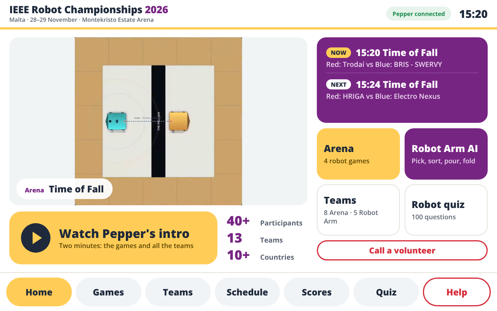
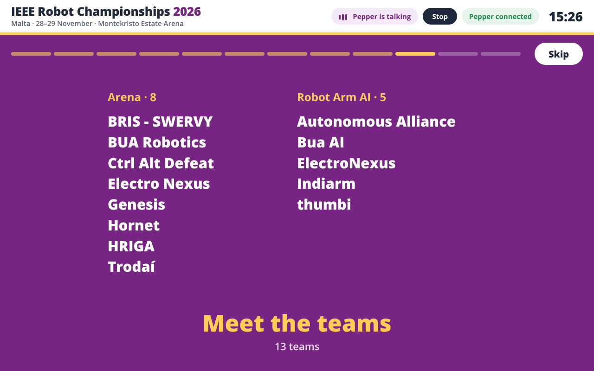

# Pepper Championship Host (v1.1.0)

Pepper as the neutral, official host of the **IEEE Robot Championships 2026** (28 and 29 November, Montekristo Estate Arena, Malta), built for the IEEE Malta Section.

Pepper opens with a **two-minute intro**: who it is, the two competitions, every game with its clip, all 13 teams by name, and what is coming next. After that the tablet does most of the work. Visitors can see the games, the teams, the programme and provisional scores, and play a **robot quiz of 100 questions**. They can also call a volunteer. Pepper calls the teams ten minutes before each block of matches.

Pepper talks when it has something useful to say, and stays quiet the rest of the time. Speech recognition in a loud arena is not reliable, so everything works by touch, and voice is a bonus.

Every team is treated the same way. Pepper never comments on a team, never favours one, and never states an official result: scores on the screen are marked provisional, and the judges announce the results.

Everything runs on the robot. Nothing is sent to the internet.

## The tablet

Built as a kiosk for Pepper's 1280 x 800 tablet, read standing up:
- **A dock of seven big buttons along the bottom** (Home, Games, Teams, Schedule, Scores, Quiz, Help), where a hand reaches without stretching. Help is outlined in red, so it is easy to find.
- **Every screen fills the tablet.** Text is at least 17 px, most of it 20 to 30 px. Buttons are at least 60 px tall.
- **Home** shows the game clips on a loop, the big **Watch Pepper's intro** button, what is on now and next (or the countdown before the event), and shortcuts to the Arena, the Robot Arm AI Challenge, the teams and the quiz.
- **The intro** takes over the whole screen in IEEE purple, with a progress bar along the top and the title in large yellow type.

## Pepper's intro

Twelve scenes, about two minutes. The tablet goes full screen while Pepper speaks, and each scene waits until Pepper has finished its sentence.

1. Hello, I am Pepper
2. Two competitions: 8 teams in the Arena, 5 in the Robot Arm AI Challenge
3. to 9. Every game, each with its clip: Time of Fall, Climate CHAOS, Weight in Line, Hanging Hazard, Pick and Place, the two-arm rounds, Tower Construction Duel
10. Meet the teams: all 13 names, Arena and Robot Arm side by side
11. What's next, from the real programme
12. Touch my screen: your turn

The intro starts:
- when a visitor touches **Watch Pepper's intro** on Home, or says "intro";
- when staff press **Start the intro now** (staff mode, Announce tab);
- by itself after a quiet spell (10 minutes by default) if someone is standing near Pepper.

Anyone can stop it: **Skip** on the tablet, or say "stop". A match call always comes first: if one is due, Pepper ends the intro and makes the call. Staff can switch the automatic intro off on the tablet, or set the box parameter to 0.

## Robot quiz: 100 questions, five at a time

Each round has five questions. The tablet keeps a shuffled bag of all 100, so no question comes back until all 100 have been asked (20 rounds). Then it shuffles again, and the first round of the new pass never repeats the five just asked. The bag survives a reload of the tablet. The three answers are shuffled each time too. Pepper reads only the question, then says "Correct!" or "Not quite", and the tablet shows the reason.

The questions cover the seven games (from the Rulebook v0.7), the event, IEEE and Malta, and how robots work. They are in `tools/quiz_bank.py`; run it to write them into `content.json`.

## What visitors can do

| On the tablet | Or say | What happens |
|---|---|---|
| Arena, Robot Arm AI | "the arena", "robot arm challenge" | The games, with an animated clip for each one |
| A game card | "what is time of fall", "explain pouring" | The clip plays, three key facts, and Pepper explains it |
| Teams | "which teams", "tell me about team ..." | Every team as a card; Pepper says where they come from and their next match |
| Schedule | "what is next", "who is playing now" | The programme, with NOW and NEXT |
| Scores | "who is winning", "scores" | Provisional leaderboards for both competitions |
| Watch Pepper's intro | "intro", "introduce yourself" | Pepper's two-minute intro (see above) |
| Robot quiz | "quiz", then "one", "two", "three" | Five questions from the 100, never repeated until all 100 were asked |
| Call a volunteer | "help", "call a volunteer", "I am lost" | A red alert on the staff screen; Pepper says a volunteer is coming |
| Help | "toilets", "food" | Good-to-know answers (edit them in `html/data/content.json`) |

Pepper also answers "who are you", "what time is it", "thank you" and "goodbye", and says a short hello when someone comes close (at most every 2 minutes). Moving between screens is silent. Pepper only speaks when someone asks, opens a game, starts the intro or the quiz, or when a match call is due.

## Install and start

1. Unzip into a new folder. Open `ChampionshipHost/ChampionshipHost.pml` in Choregraphe 2.5 and connect to Pepper.
2. Click the **Host Controller** box and set the box parameters:
   - **Staff PIN**: change it from `2026` before the event.
   - **Match calls**: on by default.
   - **Greet visitors**: on by default.
   - **Intro when idle (minutes)**: 10 by default. 0 means the intro only plays when someone asks for it.
   - **Announce match starts**: off by default, so Pepper makes one call per block of matches. Switch it on to also announce every match as it starts.
3. Fill in the teams and the programme (see below). You can also do this later on the tablet.
4. Optional: put the official `logo.png` and `mascot.png` in `html/brand/` (see the README there). Without them the tablet shows the text title only.
5. Press **Play once**. In the log you should see `[Host] v1.1.0 running. N teams, M programme items, content loaded`, `[Host] dialog loaded and listening`, and about 4 seconds later `[Host] the dialog answers: Pepper is listening`. Pepper then says hello when someone comes close.
6. For the event, install the app on the robot (Choregraphe: Robot applications, install) so it survives a reboot.

**Clean start.** The Host Controller loads the dialog itself. If an earlier run left a copy loaded, it removes that copy first (the log says `removed an old copy of the dialog left by an earlier run`), so the "topic is already loaded" error cannot stop it. If the tablet still shows **Voice not ready**:
- Stop all behaviours and start the app once.
- If that does not help, restart the robot.

The tablet keeps working either way.

## Teams and programme

Both files are in `html/data/` and open in Excel or any text editor. Lines starting with `#` are notes.

`teams.csv` already holds the official teams from the organisers' sheet (Teams & Settings): **8 Arena teams** (Trodaí, HRIGA, Hornet, BUA Robotics, Genesis, Ctrl Alt Defeat, Electro Nexus, BRIS - SWERVY) and **5 Robot Arm teams** (thumbi, Autonomous Alliance, Bua AI, Indiarm, ElectroNexus). The sheet has no countries, so that column is empty. The tablet shows the two competitions separately, each with its own count, and Pepper says "13 teams are taking part: 8 teams in the Arena and 5 teams in the Robot Arm AI Challenge."

Two details are handled on purpose:
- **Similar names.** "Electro Nexus" (Arena) and "ElectroNexus" (Robot Arm) sound the same. If someone asks for that name, Pepper names both and says which competition each is in.
- **Accents.** Pepper recognises "Trodaí" with or without the accent. If it pronounces a name wrongly, add a "say it as" spelling in staff mode or in the `say_as` column.

- **`teams.csv`** has the columns `name, country, category (arena or arm), say_as`.
  - `say_as` is optional: how Pepper should pronounce a name, if it gets it wrong.
- **`schedule.csv`** has the columns `day (sat or sun), time (HH:MM, Malta time), minutes, title, category (arena, arm or stage), game, side_a, side_b, done`.
  - For the Arena, `side_a` is the red corner and `side_b` the blue corner.
  - `game` links an item to its clip: `tof`, `chaos`, `wil`, `hh`, `colour`, `shape`, `dynamic`, `pour`, `fold` or `tower`.
  - The file already holds the organisers' **running order** (56 items): the Opening Ceremony, the robot catwalk and team spotlight, the eight AI for Humanity pitches, all 16 Time of Fall matches with their red and blue corners, every Robot Arm round with its teams, the eight Climate CHAOS runs, Sunday's knockout and finals, and the Awards Ceremony. Speeches, crew notes and breaks are left out.
  - When the sheet changes, run `python3 tools/import_running_order.py <workbook.xlsx>` to rebuild `schedule.csv`.

While there are no teams, Pepper says the list is coming soon and refers to the red and blue corners. Nothing breaks.

## Staff mode

Tap the title **IEEE Robot Championships 2026** five times quickly, then type the PIN. The staff screen has six tabs:

- **Alerts**: volunteer calls, with an "On my way" button. A new call also pops up in red while staff mode is open.
- **Teams**: add, edit or remove teams. Pepper learns the new names at once.
- **Schedule**: add matches, set the teams, mark a match as done.
- **Scores**: type each team's running total (provisional).
- **Announce**: Pepper says any text you type, plus five ready-made announcements. Here you can also switch the match calls off, start the intro now, and switch the automatic intro on or off.
- **System**: version, link and voice status, and reloading the CSV files.

Changes are kept on the robot, so they survive a restart. **Reload** goes back to the CSV files for teams and programme, and keeps scores and alerts. Staff mode closes after 5 minutes without a touch, and after 5 wrong PINs the pad waits a minute.

## Match calls

The rulebook (6.5) says staff give teams 10 minutes' notice. Pepper helps with that, without talking all afternoon:
- **One call per block.** Matches of the same game less than 10 minutes apart are one block. The 16 Time of Fall matches get one call, ten minutes before the first: "Attention teams. In ten minutes, in the Arena: Time of Fall. First match: ... in the red corner, against ... in the blue corner. Please get ready."
- The Opening Ceremony, the Awards Ceremony and other stage items of 30 minutes or more also get a call. Short items (pitches, the catwalk) do not.
- **When a match starts:** only if the box parameter **Announce match starts** is on.

Each call is made once, even after a restart. If Pepper starts late, it skips calls it missed rather than making them late. Items marked done are skipped.

Pepper's call is a help, not a replacement: staff still make sure the teams are on their way.

## The clips

The ten clips come from the two simulator videos, recut to be neutral:
- Only the arena or workspace is kept.
- Headers, side panels, captions and the robot name labels are removed.
- They are muted, because Pepper narrates.

Each clip is marked on screen as "Simulation, to show the idea. Not a real match." The facts are from **Rulebook v0.7 (final draft)**. If the rules change, edit `html/data/content.json`: the tablet and Pepper's voice both read it.

To recut the clips: `python3 tools/neutral_clips.py robo-games.mp4 robotic-arms.mp4 OUTDIR`

## How it is built (Choregraphe)

| Part | File | Job |
|---|---|---|
| Show App box | inside `behavior.xar` | Opens the tablet app |
| Dialog topic (no Dialog box) | `Host/Host_enu.top` | Listens. Each rule only writes a command (`$hostCmd`). The Host Controller loads, starts and unloads it |
| Host Controller (Python box) | `src/host_controller.py`, built into `behavior.xar` | Speaks (with gestures, without blocking), runs the dialog, moves the tablet, holds the data, makes match calls |
| Tablet app | `html/` | IEEE Malta look: white, yellow #FFCD57, purple #772583, Open Sans, pill buttons |
| Content | `html/data/content.json` | Game facts, Pepper's explanations, quiz, event facts |

Pepper only turns its head to follow people. It never drives, so it is safe with children around.

To rebuild after editing the controller, run `python3 build.py`. To run the tests, run `bash tests/run_all.sh`.

## Tested, and not yet tested

- **Tested here:**
  - The controller runs against a simulated robot on Python 3 and on Python 2.7, the robot's Python.
  - The tablet runs in Chromium at 1280 x 800.
  - The package structure, the dialog against the controller, the clips and the wording are checked automatically.
  - Deliberate bugs were planted in the code to prove the tests notice them. In v1.1, 11 bugs were planted in the intro, the quiz shuffle and the match calls. The tests caught 10. The 11th changes nothing Pepper does.
  - Every screen, including all 12 intro scenes, is checked at 1280 x 800 for text that is cut off or pushed off screen.
- **Not tested yet:**
  - A run on a real Pepper. In particular: speech recognition in a loud arena, clip playback on Pepper's own tablet browser, and the team names the dialog learns at start.
  - Please run it on the robot before the event, check the items below, and send me the Choregraphe log if anything looks wrong.

## Before the event: 10-minute check on the robot

1. Start it. Check the log shows `running` and `Pepper is listening`.
2. Touch every tile. Check the clips play.
3. Touch **Watch Pepper's intro** and let it run to the end. Then say "hello", "what is time of fall", "what is next", "quiz", then "two".
4. Open staff mode. Add a test team, add a test match 11 minutes from now, and wait for the call. Then remove both.
5. Touch "Call a volunteer" and see the alert in staff mode.
6. Change the Staff PIN.
